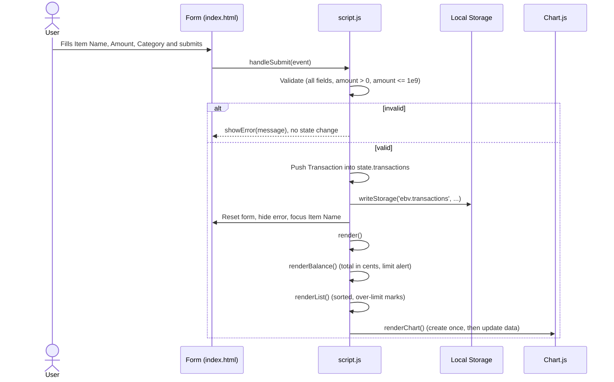

# Design Document

## Overview

Expense & Budget Visualizer is a zero-backend, no-build-step single-page application. A User records transactions through a form; the app keeps them in an in-memory array that is mirrored to the browser's Local Storage, and re-renders three views from that single source of truth: the Total Balance card, the Transaction List, and a Chart.js pie chart of spending by category.

All behavior lives in one vanilla JavaScript file (`js/script.js`) wrapped in an immediately-invoked function, so nothing leaks into the global scope. All styling lives in one CSS file (`css/style.css`) driven by CSS custom properties, which is what makes the dark/light theme a one-attribute switch. The only external dependency is Chart.js, loaded from a CDN with a classic `<script>` tag.

The design follows one rule: **state changes, then `render()` redraws everything that depends on it.** There is no partial DOM patching spread across handlers, which keeps the Total Balance, the list, and the chart consistent with each other after every add, delete, sort, or limit change.

---

## Architecture

### File Structure

```
CodingCamp-[batch date]-[participantname]/
├── index.html            # Markup only: header, balance card, form, list, chart canvas
├── css/
│   └── style.css         # The single stylesheet: theme tokens, layout, components, responsive rules
├── js/
│   └── script.js         # The single script: state, storage, rendering, event handlers
├── README.md
└── .kiro/
    └── specs/expense-budget-visualizer/
        ├── .config.kiro
        ├── requirements.md
        ├── design.md
        ├── tasks.md
        └── tasks.meta.json
```

### Script Load Order in `index.html`

```html
<!-- In <head> -->
<link rel="stylesheet" href="css/style.css">

<!-- End of <body>, after all markup -->
<!-- 1. Chart.js from CDN (defines the global `Chart`) -->
<script src="https://cdn.jsdelivr.net/npm/chart.js@4"></script>
<!-- 2. Application script (depends on the DOM and on `Chart`) -->
<script src="js/script.js"></script>
```

Both are classic (non-module) scripts with relative local paths, so the app also runs when `index.html` is opened directly. `script.js` checks `typeof Chart === 'undefined'` before drawing, so a failed CDN load degrades only the chart.

### Data Flow



Delete, sort, limit, and theme changes follow the same shape: update `state`, write the affected key to Local Storage, then call the smallest render function(s) that depend on the change.

| Event | State change | Storage key written | Re-render |
|-------|--------------|---------------------|-----------|
| Submit form | push Transaction | `ebv.transactions` | `render()` (balance, list, chart) |
| Click Delete | filter out by `id` | `ebv.transactions` | `render()` |
| Change sort | `state.sort` | `ebv.sort` | `renderList()` |
| Type spending limit | `state.limit` | `ebv.limit` | `renderBalance()`, `renderList()` |
| Click theme toggle | `state.theme` | `ebv.theme` | `applyTheme()` (also syncs chart colors) |

---

## Components and Interfaces

### 1. `index.html` — Markup

Holds the static structure; every dynamic element is located by ID.

| ID / class | Element |
|------------|---------|
| `#theme-toggle` | Theme toggle button in the header |
| `#balance-card` | Total Balance card; gets class `over-limit` when the total exceeds the limit |
| `#total-balance` | Total Balance amount (`aria-live="polite"`) |
| `#limit-alert` | "Over your limit by ..." message (hidden by default) |
| `#limit-input` | Spending limit number input |
| `#transaction-form` | Input form (`novalidate`, validated by script) |
| `#item-name`, `#item-amount`, `#item-category` | The three form fields |
| `#form-error` | Form Error message (`role="alert"`, hidden by default) |
| `#sort-select` | Sort Option select |
| `#transaction-list` | `<ul>` of Transactions (scrollable) |
| `#list-empty` | List empty-state message |
| `#chart-wrap` | Chart container (fixed 300 px height), hidden when there is no data |
| `#spending-chart` | `<canvas>` used by Chart.js |
| `#chart-empty` | Chart empty-state / load-failure message |

### 2. `css/style.css` — Styling

- **Theme tokens:** `:root` defines the light palette as custom properties (`--bg`, `--card`, `--text`, `--muted`, `--border`, `--primary`, `--danger`, `--danger-soft`, `--tag-bg`, ...); `:root[data-theme="dark"]` overrides the same names. Components only reference tokens, never raw colors, so a theme switch needs no per-component code.
- **Layout:** single column by default; `.grid` becomes two equal columns at `min-width: 768px`.
- **Small phones:** at `max-width: 480px` the header stacks and the balance font size is reduced so nothing overflows at 375 px.
- **Over-limit states:** `.balance-card.over-limit` and `.transaction-item.over-limit` share the danger tokens.
- **Scrolling list:** `.transaction-list { max-height: 360px; overflow-y: auto; }`.
- **Hidden state:** `[hidden] { display: none !important; }` so the `hidden` attribute always wins over component display rules.

### 3. `js/script.js` — Application Logic

Wrapped in `(function () { 'use strict'; ... })();` and organized in commented sections.

**Constants**

```js
const STORAGE_KEYS = { transactions: 'ebv.transactions', limit: 'ebv.limit',
                       sort: 'ebv.sort', theme: 'ebv.theme' };
const CATEGORY_COLORS = { Food: '#2ecc71', Transport: '#3498db', Fun: '#e67e22' };
const CATEGORIES   = Object.keys(CATEGORY_COLORS);        // ['Food','Transport','Fun']
const SORT_OPTIONS = ['newest', 'amount-desc', 'amount-asc', 'category'];
const MAX_AMOUNT   = 1000000000;
// currency = new Intl.NumberFormat('en-US', { style: 'currency', currency: 'USD' })
```

**Storage layer** — the only code that touches `localStorage`; every call is wrapped in `try/catch`.

| Function | Responsibility |
|----------|----------------|
| `readStorage(key, fallback)` | Parse JSON; return `fallback` on missing key, bad JSON, or unavailable storage |
| `writeStorage(key, value)` | Stringify and save; silently ignore failures |
| `loadTransactions()` | Return a valid array; drop entries with no string name, non-finite amount, or unknown Category |
| `loadLimit()` / `loadSort()` / `loadTheme()` | Validate the stored value; fall back to `null` / `'newest'` / `prefers-color-scheme` |

**State** — one object, the single source of truth:

```js
const state = { transactions: [], limit: null, sort: 'newest', theme: 'light' };
let chart = null;   // the Chart.js instance, created lazily
```

**Pure helpers**

| Function | Responsibility |
|----------|----------------|
| `toCents(value)` | `Math.round(value * 100)` — all money math is done in integer cents |
| `generateId()` | Time-based base-36 string plus a random suffix |
| `getTotalCents()` | Sum of `toCents(amount)` over all Transactions |
| `getCategoryTotals()` | Per-Category totals in `CATEGORIES` order, derived from cents |
| `isOverLimit(amount)` | `state.limit !== null && amount > state.limit` |
| `getSortedTransactions()` | Return a **copy** sorted by `state.sort`, ties broken by newest |

**Rendering**

| Function | Responsibility |
|----------|----------------|
| `renderBalance()` | Write the formatted total; toggle `over-limit` on the card; show or hide `#limit-alert` with the difference |
| `createTransactionItem(t)` | Build one `<li>` using `textContent` only (no `innerHTML`); add the over-limit class and tag; attach `data-id` to the Delete button |
| `renderList()` | `replaceChildren()` the list with sorted items; toggle `#list-empty` |
| `renderChart()` | Handle missing Chart.js and empty data; otherwise create the pie once, then update `data.datasets[0].data` and call `chart.update()` |
| `render()` | `renderBalance()`, `renderList()`, `renderChart()` |
| `applyTheme(theme)` | Set `data-theme`, update the toggle label and `aria-label`, and recolor the live chart's legend text and slice borders from the CSS tokens |

**Event handlers** — registered once in `init()`:

| Handler | Trigger |
|---------|---------|
| `handleSubmit` | `submit` on `#transaction-form` (validation, creation, persistence) |
| `handleListClick` | `click` on `#transaction-list`; event delegation, finds `button[data-id]` |
| `handleSortChange` | `change` on `#sort-select` |
| `handleLimitInput` | `input` on `#limit-input` |
| `handleThemeToggle` | `click` on `#theme-toggle` |
| `clearError` | `input` on each form field |

`init()` restores the saved Sort Option, limit, and Theme into their controls, registers the handlers, and calls `render()`.

---

## Data Models

### Transaction

```ts
// Conceptual type (implemented as a plain JS object)
type Transaction = {
  id:        string;   // unique, generated on creation
  name:      string;   // trimmed, 1–60 characters
  amount:    number;   // > 0, <= 1,000,000,000, rounded to 2 decimals
  category:  'Food' | 'Transport' | 'Fun';
  createdAt: number;   // Date.now() at creation, used for "newest first" and tie-breaking
};
```

### AppState

```ts
type AppState = {
  transactions: Transaction[];                                   // in insertion order
  limit:        number | null;                                   // null = no limit
  sort:         'newest' | 'amount-desc' | 'amount-asc' | 'category';
  theme:        'light' | 'dark';
};
```

### Local Storage Schema

| Key | JSON value | Fallback when missing or invalid |
|-----|------------|----------------------------------|
| `ebv.transactions` | `Transaction[]` | `[]` |
| `ebv.limit` | `number` (> 0) or `null` | `null` |
| `ebv.sort` | one of the four Sort Options | `"newest"` |
| `ebv.theme` | `"light"` or `"dark"` | `prefers-color-scheme` result |

---

## Correctness Properties

*A property is a characteristic or behavior that should hold true across all valid executions of a system — essentially, a formal statement about what the system should do. Properties serve as the bridge between human-readable specifications and verifiable correctness guarantees.*

### Property 1: Total Balance equals the exact sum of all amounts

*For any* set of Transactions, the displayed Total Balance SHALL equal the sum of all their amounts computed in integer cents, formatted as US dollars, and SHALL be `$0.00` for the empty set.

**Validates: Requirements 3.2, 3.3, 3.4**

---

### Property 2: Chart data is a partition of the Total Balance

*For any* set of Transactions, the Spending Chart's data SHALL contain exactly one value per Category (Food, Transport, Fun) equal to the sum of that Category's amounts, and the sum of those values SHALL equal the Total Balance.

**Validates: Requirements 4.1, 4.2, 4.3**

---

### Property 3: Add and delete change the list by exactly one Transaction

*For any* valid submission, the Transaction List length SHALL grow by exactly 1 and contain a Transaction with the submitted trimmed name, rounded amount, and Category; *for any* delete of an existing Transaction, the length SHALL shrink by exactly 1 and only the Transaction with that `id` SHALL be removed.

**Validates: Requirements 1.6, 2.4**

---

### Property 4: Invalid submissions never change state

*For any* submission where a field is empty (after trimming), the Amount is not a finite number greater than 0, or the Amount exceeds 1,000,000,000, the Transaction list, Total Balance, and Local Storage SHALL remain unchanged and the matching Form Error SHALL be displayed.

**Validates: Requirements 1.3, 1.4, 1.5**

---

### Property 5: Persistence round trip

*For any* sequence of adds, deletes, sort changes, limit changes, and theme changes, reloading the page SHALL produce the same Transactions, Total Balance, chart data, Sort Option, Spending Limit, and Theme as before the reload.

**Validates: Requirements 5.1, 5.2, 5.6, 6.6, 7.6, 8.6**

---

### Property 6: Sorting is a pure reordering

*For any* set of Transactions and any Sort Option, the displayed list SHALL contain exactly the same Transactions as the stored set, ordered by the selected key (ties broken by newest first), and the Total Balance and chart data SHALL be unchanged.

**Validates: Requirements 6.3, 6.4, 6.5**

---

### Property 7: Over-limit highlighting matches the strict comparison

*For any* set of Transactions and any Spending Limit greater than 0, a Transaction SHALL be highlighted and tagged "Over limit" if and only if its amount is strictly greater than the limit, and the Total Balance card SHALL be highlighted if and only if the total is strictly greater than the limit; *for any* unset or invalid limit, nothing SHALL be highlighted.

**Validates: Requirements 7.2, 7.3, 7.4, 7.5**

---

### Property 8: Theme toggle is an involution

*For any* starting Theme, clicking the theme toggle twice SHALL return the App to the starting Theme, and after every click the `data-theme` attribute SHALL equal the current Theme.

**Validates: Requirements 8.3, 8.5**

---

### Property 9: Transaction names are never interpreted as markup

*For any* Transaction name, including strings containing HTML tags or script text, the Transaction List SHALL display the name literally as text and SHALL NOT create elements or run code from it.

**Validates: Requirements 2.6, 2.7**

---

## Error Handling

### Invalid form input

`handleSubmit` validates in a fixed order — all fields filled, then amount is finite and > 0, then amount <= 1,000,000,000 — and stops at the first failure with the matching Form Error (Requirements 1.3, 1.4, 1.5). The Form Error uses `role="alert"` so screen readers announce it, and it disappears as soon as the User edits a field (Requirement 1.8). Native browser validation is disabled (`novalidate`) so that the messages are consistent across browsers.

### Corrupt or unavailable Local Storage

`readStorage` and `writeStorage` wrap every access in `try/catch`. Unparsable JSON, a wrong shape, or a blocked storage API yields the fallback value; invalid individual entries are filtered out on load. A failed write is ignored, so the App keeps working for the current session but will not remember the data afterwards (Requirements 5.4, 5.5).

### Chart.js fails to load

If the CDN is blocked or offline, `Chart` is undefined. `renderChart()` detects this, hides the canvas, and shows "The chart could not be loaded. Check your internet connection and refresh." Total Balance, list, form, sorting, limit, and theme are unaffected (Requirement 4.6).

### Floating-point money errors

Amounts are rounded to two decimals on entry, and totals are summed as integer cents, so values such as 0.10 + 0.20 never display as `$0.30000000000000004` (Requirement 3.3).

### Unsafe or very long names

Names are written with `textContent`, never `innerHTML`, so markup typed by the User is shown literally. The name element uses `overflow-wrap: anywhere` and its flex parent `min-width: 0`, so long unbroken strings wrap instead of widening the page (Requirements 2.6, 2.7).

### Empty states

With no Transactions, the list shows its empty-state message, the chart container is hidden in favor of its own message, and the Total Balance shows `$0.00`.

### Deleting a Transaction that no longer exists

Deletion filters by `id`; an unknown `id` simply removes nothing and re-renders the same state.

---

## Testing Strategy

The brief states that no test setup is required (NFR-1), and the logic is small enough to verify directly in the browser. Verification is therefore a **manual checklist**, with no test framework, build step, or `package.json`. The correctness properties above are the checklist's source of truth.

### Manual Test Checklist

**Form and validation (Properties 3, 4)**
- Submit an empty form → "Please fill in all fields."; nothing is added.
- Submit with a name but no category, or with an amount but no name → same error.
- Enter amount `-5` or `0` → "Amount must be a number greater than 0."
- Enter amount `2000000000` → "Amount is too large."
- Add a valid item → it appears in the list, the form resets, focus returns to Item Name.

**Balance and chart (Properties 1, 2)**
- Add `Shopping 3.56 / Fun` and `Cilok 14.94 / Food` → total `$18.50`; pie shows Food (green) and Fun (orange).
- Add `0.10` and `0.20` → total increases by exactly `$0.30`.
- Delete an item → total, list, and chart update; delete all → `$0.00`, empty messages shown, chart hidden.

**Persistence (Property 5)**
- Add items, set a limit, choose a sort, switch theme, reload → everything is restored.
- Clear site data → App starts empty in the system theme.

**Optional challenges (Properties 6, 7, 8)**
- Sort by each of the four options → order is correct and totals and chart do not change.
- Set limit `15` → only items above `$15.00` are tagged "Over limit"; the balance card turns red with "Over your limit by ..." when the total exceeds 15; clearing the field removes all highlights.
- Toggle the theme twice → returns to the original; legend text on the chart stays readable in both themes.

**Robustness (Property 9)**
- Add an item named `` → shown as literal text, no alert.
- Add an item with a 60-character name without spaces → wraps, no horizontal page scroll.
- Block `cdn.jsdelivr.net` (DevTools → Network) → chart message appears, everything else still works.
- Open in a private window with storage blocked → the App works without errors in the console.

### Browser and Device Matrix

- Chrome, Firefox, Edge, and Safari (latest versions) — full checklist on at least one, smoke test (add, delete, chart, theme) on the others.
- Phone-width viewport of 375 px — no horizontal scroll, form and buttons usable by touch.
- Viewport of 768 px and wider — Transactions and chart cards side by side.

### Deployment Check

- Open the GitHub Pages URL, confirm `css/style.css`, `js/script.js`, and Chart.js all load without 404 errors in the console, and repeat the smoke test on the published site.
